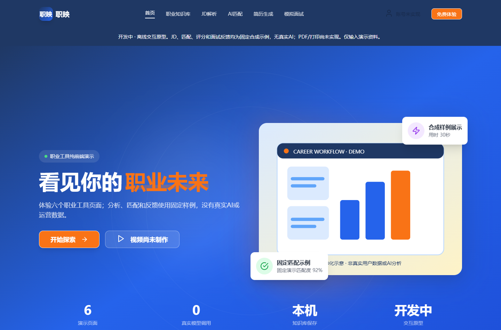

# 职映 · Vite 职业工具交互原型

用一套蓝橙色前端串联职业知识库、JD展示、岗位匹配、合成简历和面试练习，保留早期职业工具的六页界面与交互思路。

**开发中 / 固定合成演示**。这是独立 React/Vite 实现，区别于另一个 Next.js `zhiying` 项目。没有真实 AI、职业数据库、运营用户、岗位匹配算法、账号或后端；界面评分和反馈是固定示例，不构成求职建议或作者真实履历。

[在线预览](https://yangwei251003.github.io/zhiying-vite-prototype/) · [实际验证与限制](docs/OPEN_SOURCE_VALIDATION.md) · [来源许可](THIRD_PARTY_NOTICES.md) · [依赖安全记录](docs/DEPENDENCY_SECURITY.md)



## 实际能力

| 页面 | 当前行为 |
|---|---|
| 首页 | 功能导航、响应式布局与自有SVG；统计改为可核实的页面/状态信息，虚构评价明确标记 |
| 职业知识库 | 编辑字段、预览和写入/恢复本浏览器localStorage，独立存储键，不读取另一套职映数据 |
| JD解析 | 输入后等待并展示同一固定样例；文件按钮不解析真实文档 |
| AI匹配 | 等待后展示固定82分样例；不评估输入或真实用户 |
| 简历生成 | 编辑与模板切换可预览，默认全部合成；生成动画、打印/PDF仍是占位提示 |
| 模拟面试 | 固定题库、计时与固定反馈，可练习页面操作；不真实判断回答质量 |

登录不可用；JD报告导出和部分页内快捷按钮未接线。各模块通过顶部/页脚导航进入，知识库与其它模块尚未连接。没有将未完成操作包装成可用导出或AI能力。

## 快速上手

需要 **Node.js24、npm11**（本次验证环境）；首次安装需联网，不需要模型、密钥、账号或付费服务。

```sh
git clone https://github.com/yangwei251003/zhiying-vite-prototype.git
cd zhiying-vite-prototype
npm ci
npm run build
npm run preview -- --host 127.0.0.1
```

打开命令显示的本机地址，通常是 **http://127.0.0.1:4173**。开发用 `npm run dev -- --host 127.0.0.1`。使用HashRouter，页面链接如 `#/knowledge-base`，刷新不需要服务器伪静态。GitHub Pages只发布dist，按仓库名设置构建前缀；源码保留在仓库。

请只填写合成演示内容，不输入私人简历、财产、账户、密钥、证件、联系方式、住址/GPS或真人照片。知识库只存当前浏览器，清理站点数据会删除内容；其它页面主要是本次会话状态，不自动上传GitHub或云端。

## 技术与目录

React18、Vite6.4.5、React Router6、Ant Design5、Lucide、Tailwind3、PostCSS；具体补丁与完整性固定在package-lock.json。Vite5已停止支持，本次按官方迁移指南最小升级至受支持6.4分支，未强制改造到Vite8/Tailwind4/Router7。

```text
src/pages/            六个页面与固定样例
src/components/       导航和页脚
src/theme.jsx         Ant Design主题
public/illustrations/ 两张自有程序化SVG，非真人/真实分析
docs/                 当前验证、安全范围、真实截图
scripts/              实际生产依赖原文归档
licenses/             完整原文与确证上游补充
```

```sh
npm run lint
npm run build
npm run licenses:generate
```

原件没有自动化测试套件，原lint配置缺失；本次补基础语法/未定义变量/JSX key/Hooks检查，并做隔离Chrome实际流程验收。构建保留大于500kB产物提示；后续可做按页拆分，未通过调大阈值隐藏警告。

依赖审计仍有 **5项moderate**（Router6及Tailwind3解析链），具体使用路径与未验证范围见安全文档，不宣称无漏洞。后续计划是迁移这些旧依赖、连接实际数据、设计真实模型接口及实现导出，届时需要独立验证。

自有源码和SVG遵循[MIT](LICENSE)，依赖保留原协议。完整自有代码保留；排除依赖、构建缓存、机器目录、私人配置和不能确认再发布的远程生成图片。原项目暂不列为可本地删除，远端部署与完整性仍待主发布流程核对。
